# Game design, world map, and curriculum progression

**Status:** proposed content architecture. Region order is a learning scaffold, not a fixed level count or claim that content exists.

## 1. World premise and progression

The world, **Asteria**, is a network of floating biomes powered by a dormant Logic Engine. Each region introduces a Python idea through exploration, NPC requests, a focused challenge, and a traversal/combat application. A central **Wayfinder Hub** connects the regions. The learner restores sixteen engine seals; the finale combines them in the **Convergence Arena**.

### World graph

```mermaid
flowchart LR
  H[Wayfinder Hub] --> V[1 Variable Vale]
  V --> T[2 Typeworks]
  T --> C[3 Branching Wilds]
  C --> L[4 Looping Canopy]
  L --> F[5 Function Foundry]
  F --> S[6 String & Collection Coast]
  S --> D[7 Algorithmic Deep]
  D --> O[8 Object Citadel]
  O --> E[9 Exception Peaks]
  E --> M[10 Module Archive]
  M --> N[11 Numerical Expanse]
  N --> P[12 Pandas Delta]
  P --> Z[13 Visualization Observatory]
  Z --> ML[14 Model Frontier]
  ML --> AI[15 Intelligence Nexus]
  AI --> X[16 Convergence Arena]
  H -. practice return paths .-> V
  H -. fast travel after discovery .-> T
  H -. fast travel after discovery .-> D
  H -. fast travel after discovery .-> M
  H -. fast travel after discovery .-> AI
```

The arrows show recommended main-quest order. Side routes within each region unlock from hub checkpoints and mastery gates. Revisit paths remain open after discovery. Fast travel avoids requiring repeated traversal; it unlocks per activated checkpoint.

### Unlock and gate model

- Start: Hub orientation, movement tutorial, accessible practice terminal; no coding prerequisite.
- Main path: complete region introduction and at least one required challenge with server-validated success. A learner may retry without penalty.
- Mastery gates: optional challenge set recommends a concept review when evidence suggests confusion; do not permanently lock the campaign on a single failed assessment.
- Remediation: every region links to a hub practice room and prerequisite concept cards. Teacher assignment may unlock a safe practice instance, not bypass server-side reward rules.
- Checkpoints: hub, region entrance, quest milestones, boss arena; checkpoint state is saved only after backend acknowledgement.
- Region completion reward: cosmetic/recipe/currency plus a capability token. Values, economy pacing, and anti-grind limits require playtesting.

## 2. Region design matrix

| # | Region / subregions | Concept and traversal application | Main quest / gate encounter | Side quests and checkpoints |
|---|---|---|---|---|
| 1 | Variable Vale: Arrival Pier, Label Gardens, Signal Tower | Variables, assignment, `print`, `input`; route beacons read learner-supplied values | “Light the Way”: map signal coordinates; Beacon Warden tutorial | NPC delivery, name-a-beacon; pier, tower |
| 2 | Typeworks: Casting Quarry, Operator Foundry | `int`, `float`, `str`, `bool`; operators; repair bridges with correct types | “Balance the Foundry”: calculate load/energy; Forge Golem | Type sorting and conversion trials; quarry, foundry |
| 3 | Branching Wilds: Forked Trail, Weather Grove | comparisons, boolean logic, `if/elif/else`; choose safe route based on state | “The Two Roads”: route selector; Briar Judge | Branching races and lost scout; trailhead, grove |
| 4 | Looping Canopy: Vineways, Windmill Crown | `for`, `while`, ranges, loop control; repeat timed jumps and activate switches | “Turn the Windmills”: schedule actions; Canopy Stag | Seed collection, loop race; canopy base, crown |
| 5 | Function Foundry: Blueprint Quarter, Recursion Vault | parameters, return values, scope, decomposition, introductory recursion | “Build a Bridge”: reusable span function; Recursive Sentinel | Refactor workshop and optional recursion puzzle; quarter, vault |
| 6 | String & Collection Coast: Echo Beach, Listwood, Map Caves | strings, slicing, lists, tuples, sets, dictionaries; route from structured inventory | “Recover the Names”: parse message and organize supplies; Tide Archivist | Sorting shells, dictionary deliveries; beach, caves |
| 7 | Algorithmic Deep: Search Shoals, Sorting Reef, Complexity Trench | data structures, search/sort, stacks/queues, algorithm choice and basic complexity | “Find the Lost Current”: search and route plan; Deep Guardian | Timed algorithm trials with untimed accessibility mode; reef, trench |
| 8 | Object Citadel: Class Gate, Inheritance Hall, Arena | classes, instances, methods, composition, inheritance; configure gear objects | “Forge a Guardian”: model equipment; Citadel Automaton | Repair NPC objects; gate, hall, arena |
| 9 | Exception Peaks: Trace Pass, Debugger Ridge | exceptions, validation, tracebacks, debugging; recover a failing traversal system | “Stabilize the Lift”: find and handle faults; Fault Colossus | Bug bounty board and safe fault drills; pass, ridge |
| 10 | Module Archive: Import Atrium, Fileworks, Package Tower | modules, imports, file formats, context managers; assemble a multi-file-style mission via provided modules | “Restore the Index”: read structured records; Archive Keeper | Catalog cleanup; atrium, tower |
| 11 | Numerical Expanse: Vector Flats, Matrix Mesa | NumPy arrays, shape, vectorized operations, numerical reasoning; calculate force fields | “Align the Arrays”: solve a sensor grid; Tensor Beast | Precision and scaling puzzle; flats, mesa |
| 12 | Pandas Delta: Stream Tables, Cleaning Marsh, Join Estuary | DataFrames, selection, missing values, grouping, joins; analyze expedition data | “Find the Safe Channel”: derive route from records; Delta Surveyor | Data cleanup and supply report; docks, estuary |
| 13 | Visualization Observatory: Chartworks, Sky Gallery | chart choice, axes, labels, encoding, interpretation; construct a useful visualization specification | “Tell the Weather”: compare regional patterns; Lens Guardian | Improve misleading charts; chartworks, gallery |
| 14 | Model Frontier: Feature Fields, Training Ridge, Evaluation Basin | ML workflow, train/test separation, features, baseline, metrics, bias/limits; tune a safe simulated model | “Predict the Storm”: evaluate forecast quality; Overfit Wyrm | Feature investigation and metric comparison; fields, basin |
| 15 | Intelligence Nexus: Knowledge Garden, Agent Lab, Ethics Gate | AI concepts, search/planning, model limits, responsible use; program a bounded ally policy | “Coordinate the Sentinels”: plan multi-step actions; Nexus Council encounter | Explainability and failure analysis; garden, lab |
| 16 | Convergence Arena: Trial Rings, Team Circuit, Engine Core | Integrated Python, debugging, data, algorithms, OOP, AI/ML critique | Multi-stage capstone; Logic Engine final boss; score uses transparent rubric and server-validated artifacts | Optional rematches with different constraints; ring gates and core |

## 3. Quest and encounter template

Every authored quest/challenge version includes: stable ID, version, region/subregion, learning objectives, prerequisites, estimated duration, narrative brief, visible examples, starter state, allowed libraries, visible/hidden test policy, time/resource limits, rubric, hint ladder, accessibility adaptations, rewards, failure/retry behavior, telemetry events, localization keys, author/reviewer, and publication status.

Main quests connect story and required objectives. Side quests provide practice and narrative context without blocking the main route. Repeatable challenges rotate parameterized datasets and cap rewards to avoid farming. Bosses have readable phases, assist options, deterministic mechanics, and no reward depends on model-generated grading.

## 4. Python curriculum progression

| Stage | Prerequisite evidence | Learning objectives | Challenge evidence |
|---|---|---|---|
| A: communicate | none | expressions, variables, input/output, types, operators | compute and print a correct result across varied inputs |
| B: decide/repeat | A | conditions, boolean logic, loops, ranges | branch across edge cases; iterate with correct termination |
| C: structure | B | functions, parameters, return values, strings, collections | decompose a task and manipulate structured data |
| D: solve | C | algorithms, data structures, complexity intuition, OOP | choose a data representation and implement reusable behavior |
| E: diagnose/build | D | exceptions, debugging, files, modules | identify failure cause and safely process records |
| F: compute/analyze | E | NumPy, Pandas, visualization | transform data and justify a chart/analysis result |
| G: model/reflect | F | ML workflow, AI concepts, evaluation, responsible use | compare model to baseline, explain limits, design bounded behavior |
| H: integrate | A–G | capstone across concepts | solve multi-part task, explain approach, pass hidden cases and rubric |

Progress is objective-level evidence, not a linear XP proxy. Record first-pass and eventual success, errors by misconception category, hint depth, latency, and later retrieval. Adaptive recommendations can change practice order; they may not silently lower a published criterion or award mastery.

## 5. Content ownership and validation

Store region, quest, dialogue, challenge, rubric, and reward data as versioned content assets. Unity uses ScriptableObjects for client-authored presentation/configuration where appropriate; backend challenge definitions and hidden tests remain server-owned and versioned. A content validator should check IDs, references, prerequisites, hint ordering, localization coverage, reward bounds, and graph reachability before publication.
