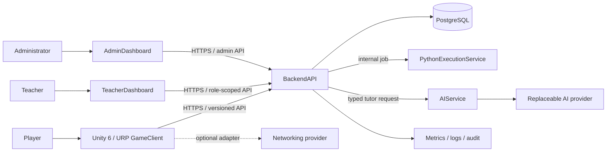

# Core systems and Unity client architecture

**Status:** proposed design. Assembly names and boundaries are architectural targets, not existing code. Initial target is Windows 10/11 x64 and installed Unity 6000.3.19f1 per [ADRs 0008–0009](adr/0008-initial-platforms.md); no Unity project or package manifest exists yet.

The backend has an initial implementation, and the Unity repository now contains its first runtime/API client foundation. The API and tables cover catalog reads, profile initialization, and caller-owned progress/award/submission metadata reads. The Unity greybox runtime provides movement, camera, input and interaction boundaries plus a typed catalog/profile client; editor package resolution and compilation remain pending license activation. Execution, scoring, quest completion mutation, and dashboards are not implemented; see the [v1 route inventory](api/README.md) and [Unity setup](../GameClient/README.md).

## 1. System context



Trust boundaries: player device is untrusted; dashboards are untrusted clients; public API is a boundary; execution worker is hostile-code containment; AI provider is an external data processor and untrusted text source; PostgreSQL and service credentials are private.

## 2. Gameplay systems specifications

| System | Responsibility / interfaces | Dependencies and integration | Failure handling / security | Testing |
|---|---|---|---|---|
| Player movement | Input abstraction, third-person locomotion, jump, camera-relative motion | Input System, physics, camera rig | Invalid input falls back to neutral; movement never grants backend progress itself | EditMode state tests; PlayMode movement, slope, respawn checks |
| Camera | Follow/orbit, collision, sensitivity, accessibility settings | Player target, input settings | Clamp pitch/sensitivity; recover if target is destroyed | PlayMode collision, target-loss tests |
| Traversal | Parkour, moving platforms, rotating hazards, checkpoints | Physics, animation, region data | Deterministic reset and assist options; checkpoint saved after server ack | PlayMode hazard/platform/checkpoint cases |
| Interaction/dialogue | Focus selection, NPC dialogue, quest actions | Content catalog, UI, quest state | Reject malformed/missing content; no reward based solely on client dialogue action | Content validation + PlayMode flows |
| Challenge client | Editor, submit/status/result display, hints | Backend API, challenge metadata | Never ships hidden tests; timeout/outage displays retryable state; idempotency key | Contract tests, PlayMode submit/error paths |
| Quest/progression | Local presentation of server-owned state and event intents | API, content graph, save service | Server response is authority; stale state prompts refresh | State-machine and integration tests |
| Combat/abilities | Readable attack, enemy states, code-powered ability effects | Movement, combat data, server-validated unlocks | Client animation cannot mint unlock or competitive score | Deterministic encounter tests |
| Enemies/bosses | Data-driven state machines, phases, tells, assist settings | Combat, AI navigation, encounter content | Bounds/perception checks; reset to safe state on invalid content | Unit state tests and representative PlayMode encounter |
| Inventory/equipment/crafting/economy | Present owned items, equip/craft intents, recipes and prices | Backend inventory API, content catalog | Server validates ownership, cost, quantities, replay; client cache is non-authoritative | API authorization/idempotency and UI tests |
| Save/load | Cache presentation state and sync authoritative account state | Backend, local secure storage policy | Versioned migrations; detect conflict/offline stale writes; no silent overwrite | Migration, conflict, reconnect tests |
| Settings/accessibility | Input remapping, audio/display, text/subtitles, assists | Unity settings, UI, persistence | Defaults always recoverable; validate ranges | Settings persistence and accessibility review |
| UI/HUD | Navigation, status, dialogue, quest/challenge overlays | UI Toolkit or uGUI choice TBD; localization | Safe empty/error states, keyboard/controller navigation | Navigation, focus, resolution tests |
| Audio/animation | Feedback and presentation | Addressables/content, gameplay events | Missing assets degrade gracefully | Content reference checks and scene smoke test |
| Telemetry | Minimized gameplay events with consent/config | Backend analytics contract | No code contents or secrets by default; enforce retention/consent | Schema validation and privacy tests |

Every system should have a clear owner assembly, narrow interface, content dependencies, state ownership, timeout/invalid-state behavior, unit/integration test plan, and defined telemetry. Avoid global service locators and cross-assembly reach-through.

## 3. Unity project layout and assembly boundaries

```text
GameClient/
  Assets/CodeQuest/
    Runtime/
      Foundation/       # primitives, clock, IDs, logging abstractions
      Content/          # runtime content contracts/loaders
      Player/           # movement, camera, input adapters
      World/            # regions, traversal, checkpoints
      Quests/           # quest state presentation and interaction
      Challenges/       # editor, submission, results
      Combat/           # abilities, enemies, encounters
      Progression/      # UI-facing projections, inventory intents
      UI/               # navigation, HUD, dialogue, accessibility
      Infrastructure/   # API, storage, analytics, networking adapters
    Content/             # ScriptableObject assets, localized text, Addressables groups
    Scenes/              # Bootstrap, Hub, region scenes, test scenes
    Art/ Audio/ Prefabs/ Settings/
  Packages/manifest.json
  ProjectSettings/
  Tests/EditMode/ Tests/PlayMode/
```

Proposed asmdefs: `CQ.Foundation`; `CQ.Content`; `CQ.Gameplay.Player`; `CQ.Gameplay.World`; `CQ.Gameplay.Quests`; `CQ.Gameplay.Challenges`; `CQ.Gameplay.Combat`; `CQ.Gameplay.Progression`; `CQ.UI`; `CQ.Infrastructure`; matching test assemblies. Dependencies point inward to Foundation/contracts. UI depends on use-case interfaces rather than concrete networking. Editor-only validators live in `Assets/CodeQuest/Editor/` and editor asmdefs, never in runtime assemblies. Exact directory placement must be verified against selected Unity packages.

Unity conventions: record `6000.3.19f1` in `ProjectSettings/ProjectVersion.txt` when scaffolding; commit `Packages/manifest.json` and Package Manager lockfile; use only package versions offered/compatible in that editor. Do not auto-upgrade the editor or select versions based on a floating latest tag. One public MonoBehaviour/ScriptableObject per matching file, `CodeQuest.<Area>` namespaces, explicit asmdef references, and no `UnityEditor` reference from runtime assemblies. See [ADR-0009](adr/0009-unity-editor-version.md).

### Client state ownership

- Client owns transient presentation, input, animation, local editor buffer, camera/settings cache.
- Backend owns identity, challenge outcomes, hidden-test verdict, curriculum completion, inventory, economy, account save, teacher assignment, and analytics access policy.
- AI owns no persistent gameplay state or scoring. Its response is advice only.
- Content authoring assets may define visible challenge data; hidden tests and reward rules are not included in downloadable Unity assets.

## 4. Replaceable interfaces

Suggested ports: `IApiClient`, `IAuthSession`, `IChallengeSubmissionService`, `IProgressionRepository`, `ISaveRepository`, `ITutorClient`, `IExecutionJobClient`, `INetworkSession`, `IAnalyticsSink`, `IClock`, `IRandomSource`. Provider-specific packages live behind adapter assemblies and must not leak provider types into core domain contracts. Version these contracts deliberately.

## 5. Runtime lifecycle and failure patterns

Bootstrap validates configuration, loads user settings, establishes session, fetches server version/content manifest, then enters hub. Use explicit async cancellation on scene changes, bounded retry with jitter for transient idempotent reads, and idempotency keys for writes. Challenge submission survives navigation or reports job status; do not resubmit implicitly. Lost connection preserves local authored code and shows whether the attempt was accepted. Server confirmation reconciles local projections.
