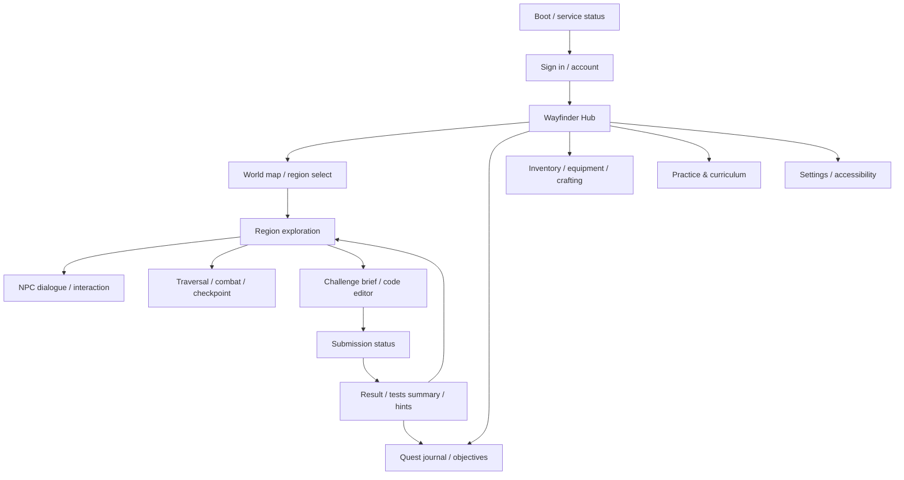

# UX, dashboards, analytics, and multiplayer

**Status:** proposed information architecture; visual design and age-specific research remain future work.

## 1. Screen inventory and navigation

### Game client

Screens: boot/service status; sign-in/account; hub; world map; region HUD; quest journal; dialogue; challenge brief/editor; submission status; result and hint panel; inventory/equipment; crafting/vendor; profile/mastery; achievements; multiplayer lobby (later); settings; accessibility; pause; reconnect/error; credits/legal/privacy.

### Teacher dashboard

1. Sign-in and class switcher.
2. Class roster and enrollment management.
3. Assignment builder (curriculum objective/challenge/version, due date, supports).
4. Class overview (completion, aggregate trends, data freshness).
5. Learner detail (attempt timeline, objective evidence, hints used; controlled access).
6. Content preview and accessibility review.
7. Export/report request with scope and audit trail.

### Admin dashboard

1. Service/queue health and alerts.
2. User/role/scope administration.
3. Content draft, validate, review, publish, rollback-to-prior-version workflow.
4. Challenge test/rubric inspection with role-gated hidden material.
5. Audit log, feature flags, retention and provider configuration status (secrets are never displayed).
6. Tenant/platform settings and operational support actions.

## 2. UX behavior requirements

- Show region goal, prerequisites, controls, and learning objective before challenge entry.
- Editor supports examples, input fixtures, submission state, visible feedback, retry, and retained draft after transient failure. Exact editor implementation/package TBD; avoid silently sending local drafts to AI.
- Hidden tests are summarized safely (for example, “one edge case failed”) without exposing expected values or test source.
- Tutor hints are opt-in, staged, dismissible, and distinguish authored guidance from AI-generated text. Avoid shame language and punitive retry costs.
- Keyboard and controller navigation, visible focus, text scaling, subtitles, color-independent status, readable contrast, audio controls, motion reduction, and assist settings are included in design reviews.
- Teacher data views show definitions, time range, sample size, and limitations. Do not present mastery estimates as certainty or rank learners by raw speed.
- Loading, empty, unauthorized, offline, timeout, stale data, rate-limited, and service-unavailable states are designed, not placeholder success screens.

## 3. Analytics and event policy

Proposed events: `region_entered`, `checkpoint_reached`, `quest_state_changed`, `challenge_attempt_created`, `challenge_attempt_completed`, `hint_requested`, `objective_evidence_updated`, `assignment_viewed`, `service_error`. Events use pseudonymous IDs and schema version. Do not collect chat transcript, source code, filesystem path, secrets, precise location, or unnecessary demographics by default. Consent, age handling, retention, data residency, deletion/export, and school reporting policies must be approved before telemetry is enabled.

Analytics pipeline starts with transactional records and bounded aggregate queries in PostgreSQL; avoid adding a separate warehouse until volume and privacy requirements justify it. Teacher endpoints enforce class scope and suppress or aggregate small cohorts where re-identification is possible (threshold TBD). Audit access to learner detail and exports.

## 4. Optional multiplayer architecture and threat model

Networking remains behind `INetworkSession`/`INetworkTransport` adapters. Provider/transport selection is TBD; do not let provider IDs or SDK types leak into gameplay domain assemblies. Start with invitation-only cooperative presence after single-player state and identity are stable. Define authoritative server simulation and rollback/latency needs before combat co-op implementation.

### Authority model

- Server owns identity, party membership, quest rewards, inventory/economy, challenge results, leaderboard records, and competitive score.
- Client sends intents, not trusted state snapshots. Server validates position/action envelopes where competitive integrity matters.
- A player may not host an authoritative competitive match on a modified client; authoritative simulation runs in trusted service/managed host.
- Challenge execution is isolated and bound to the authenticated attempt; remote participants cannot read private tests or another player's source.

### Threats and mitigations

| Threat | Mitigation / remaining issue |
|---|---|
| Forged completion, score, inventory, or currency | Server recomputes/validates transitions; idempotency, replay protection, audit and anomaly detection |
| Modified client / speed hack | Server validates competitive movement/actions; cooperative PvE can tolerate more client prediction; game-specific anti-cheat scope TBD |
| Replay or duplicate request | Nonce/idempotency keys, attempt state machine, bounded token lifetime |
| Chat harassment, grooming, spam | Launch multiplayer only after moderation, report/block, rate limits, age policy, and response operations exist; chat defaults and policy TBD |
| Account/session theft | OIDC controls, secure token storage, revocation, risk monitoring |
| DDoS/resource exhaustion | Gateway limits, queue quotas, matchmaking admission control, autoscaling and incident runbook |
| Cross-party/class data leakage | Authorization on every resource and party-scoped routing; contract/security tests |
| Provider compromise/lock-in | Adapter boundary, minimal data sharing, exit plan, versioned transport messages |

No multiplayer launch until privacy/age requirements, moderation ownership, server authority, cost, and incident response are approved.
