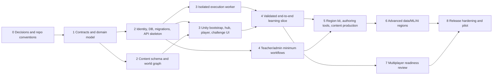

# Quality, delivery, assets, risks, and implementation roadmap

**Status:** proposed plan, updated 2026-10-11. Repository conventions/CI and the initial versioned API, schema, and migration foundation are complete; dates and staffing are TBD.

## 1. Test strategy and release acceptance

| Layer | Coverage focus | Gate |
|---|---|---|
| Unit | domain rules, quest graph, scoring, state machines, authorization policy, hint policy | deterministic, no external service required |
| Contract | OpenAPI schemas, Unity DTO compatibility, worker job protocol, AI provider mapping | schema compatibility check in CI |
| Integration | API + PostgreSQL, migrations, identity adapter, queue/worker lifecycle | ephemeral local service dependencies |
| Security | authz/tenant isolation, rate limits, code sandbox escape/resource tests, secret scanning, dependency review | blocking before release; threat cases documented |
| Unity EditMode/PlayMode | movement, checkpoint, challenge state, UI focus, reconnect and scene lifecycle | editor/batchmode on pinned Unity version |
| E2E acceptance | learner journey from account to challenge to validated progression; teacher assignment/report | repeatable seeded local environment |
| Content validation | world graph reachability, challenge schema, hidden-test privacy, reward bounds, localization keys | all content bundle builds |
| Performance/accessibility | frame time, memory, load time, resolution/device matrix, keyboard/controller and assist review | budgets below; device matrix TBD |

Tests should use deterministic fixtures and avoid real model calls by default. Provider integration smoke checks must be optional, isolated, and credential-safe. Sandbox tests run only in disposable CI infrastructure with no valuable credentials.

### Proposed initial acceptance budgets (validate in prototype)

- Client: target 60 FPS on agreed minimum PC at target settings; p95 frame time ≤ 16.7 ms after warm-up; no mandatory ultra settings. Minimum device/GPU TBD.
- Client memory: establish per-platform ceiling before content production; provisional 4 GB process budget on minimum PC (TBD).
- API: p95 ordinary read ≤ 300 ms and submission acknowledgement ≤ 1 s excluding execution queue; p95 end-to-end challenge result target ≤ 10 s for short challenge. Validate with workloads.
- Worker: enforce per-challenge configurable CPU ≤ 2 s, wall ≤ 5 s, memory ≤ 128 MiB, one process, stdout+stderr ≤ 64 KiB; these are provisional defaults and must be calibrated against curriculum/library needs.
- Local development: core API, DB, AI fallback, and one worker should fit a 16 GB Windows Docker Desktop machine; editor and Unity may run separately.

The initial supported target is Windows 10/11 x64, with Unity 6000.3.19f1 installed on the inspected workstation. See [ADRs 0008–0009](adr/0008-initial-platforms.md). Python execution isolation is a per-job restricted Linux container, with residual risks and release gates in [ADR-0011](adr/0011-python-execution-isolation.md).

## 2. CI/CD and deployment

### CI pipeline

1. Validate formatting/lint/type checks and secret scan.
2. Run backend, dashboard, and content unit tests.
3. Build API, AI, worker, and dashboard images/artifacts with pinned base images and SBOM.
4. Run migrations on clean and previous supported schema; contract/security checks.
5. Run worker adversarial tests in isolated job.
6. Build Unity client in pinned Unity 6 editor; EditMode/PlayMode suite and content validation.
7. Package signed/versioned artifacts; promote same artifact through environments.

### Deployment plan

- Local: `Infrastructure/compose.yaml` for PostgreSQL, API, AI fallback/service, worker queue, dashboards; secrets via local untracked env file or secret store, never committed.
- Environments: local → integration → staging → production; distinct accounts/data and credentials. Cloud provider and regions TBD.
- Production: TLS termination, private DB/worker networks, managed secret storage, backups/PITR, health probes, structured redacted logs, metrics/traces, alerting, rate limiting, queue backpressure, rollback and incident runbooks.
- Container images pinned by digest at release. Execution worker is separate, restricted, and scaled independently. Migrations use expand/contract.
- No deployment automation until target host, student data handling, availability targets, and budget are chosen.

## 3. Asset pipeline, licensing, performance

- Track source and license/provenance for code, fonts, textures, models, audio, animations, and generated assets. Maintain `Documentation/asset-register.csv` (planned) with source, author, license, attribution, modification, and redistribution terms.
- Prefer original assets, permissive CC0/CC-BY with required attribution, and compatible open-source tools. Legal review before commercial distribution; do not assume marketplace/free assets permit redistribution.
- Unity import presets, naming conventions, texture/audio compression targets, LOD/collider policy, Addressables groups, bundle versioning, and localization rules should be established before bulk import.
- Proposed budget per streamed region: 1–2 km navigable footprint only if gameplay requires it (TBD), bounded draw calls and material variants after profiling; use profiler baselines rather than assert universal counts. Avoid loading all sixteen regions simultaneously.
- Keep authored source assets outside generated/import caches; include asset license validation in content review.

## 4. Risk register

| ID | Risk | Probability / impact | Mitigation / trigger |
|---|---|---|---|
| R1 | Untrusted Python escapes isolation or exhausts host | Medium / Critical | separate worker, defense in depth, quotas, no network/secrets, adversarial tests; block external pilot until reviewed |
| R2 | Unity/content scope overwhelms delivery | High / High | content schema, vertical slice, region kit, milestone gates, playtest capacity |
| R3 | Learning loop rewards guessing rather than understanding | Medium / High | varied hidden cases, objective evidence, retrieval checks, educator review |
| R4 | AI gives harmful/incorrect answer or leaks learner data | Medium / High | authored fallback, staged policy, redaction, provider review, no authority, report/monitor |
| R5 | Privacy/child/student law and consent unresolved | High / Critical | select audience/jurisdiction and consult qualified reviewer before data collection/launch |
| R6 | Economy/progression exploited through replay or modified client | Medium / High | backend authority, idempotency, audit, anomaly testing |
| R7 | Multiplayer moderation/abuse burden underestimated | Medium / High | defer launch until policy, tooling, staffing and incident response are defined |
| R8 | Provider/cloud costs or lock-in | Medium / Medium | open interfaces, local fallback, cost telemetry, export/exit plan |
| R9 | 16 GB Windows development becomes impractical | Medium / Medium | slim compose profile, lazy build, memory profiling, Unity asset budgets |
| R10 | Accessibility/curriculum content added too late | Medium / High | include review in templates and acceptance gates from first slice |
| R11 | Empty Git history/no contributor conventions | High / Medium | establish initial commit/branch protections and CI conventions before collaboration |
| R12 | Exact Unity 6 editor/package compatibility unknown | Medium / High | verify installed editor and pin patch/package set before creating project |

## 5. Dependency graph and staged roadmap

### Milestones

0. **Decisions and repo conventions — complete:** ADRs record audience/privacy, platforms/editor, identity boundary, and Python isolation; contributor guidance, pinned Python tooling, CI, and ignore/config rules are present.
1. **Contracts and domain — initial slice complete:** `/api/v1` catalog and learner read/profile routes, OpenAPI snapshot, initial content schema, seed data, threat model, and reversible PostgreSQL migration exist. Broader route and domain scope remains planned.
2. **Platform foundation — initial backend complete:** FastAPI modular monolith, PostgreSQL migrations, OIDC JWT verification boundary, local Compose service, and SQLite-backed test suite exist. PostgreSQL execution and dashboards remain to be completed/validated.
3. **Execution and client shell:** hardened worker prototype; Unity bootstrap, input/camera/controller, hub/one representative region, challenge editor/submit/result, authored tutor fallback.
4. **Verified vertical slice:** account → challenge → real isolated Python → hidden tests → backend-validated reward/progression → persisted resume; teacher assigns and reviews aggregate progress.
5. **Reusable content kit:** quest/NPC/encounter authoring, region template, content validator, first four curriculum regions and accessible traversal/combat loop.
6. **Full curriculum production:** regions 5–16 in dependency order, AI tutor integration after privacy/provider decision, NumPy/Pandas environment policy, dashboards and analytics expansion.
7. **Multiplayer decision gate:** select provider only after threat/cost/ops review; implement co-op first if approved; competitive mode separate.
8. **Pilot and release hardening:** learning evaluation, accessibility, security testing, localization, observability, backup/restore, deployment, support/moderation and store/legal readiness.

Estimate staffing and calendar only after team size, art/content throughput, pilot scope, and platform targets are known.

## 6. Exact next implementation task

**First editor validation, then reusable learning interactions:** activate the installed Unity editor license, resolve the pinned packages, run the project setup action, compile, and run EditMode/PlayMode tests. Then expand the foundation into reusable world interaction, authored interactables, quest state, dialogue, player persistence, and the learning challenge framework against the versioned backend. Do not begin mass region content production yet. See [Unity architecture](03-systems-and-client-architecture.md), [Unity setup](../GameClient/README.md), and the [API inventory](api/README.md).
